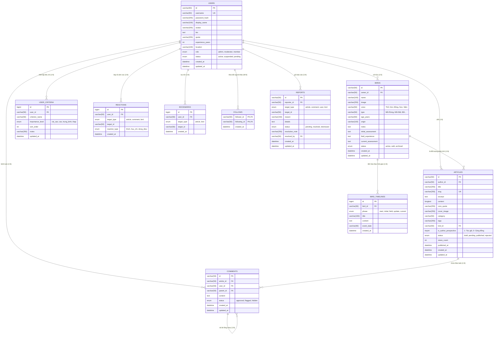

# Tài Liệu Thiết Kế Cơ Sở Dữ Liệu (Database Design)
## Website Sổ Tay Chọn Chim Cu Gáy & Thư Viện Quan Điểm Cộng Đồng

---

## 1. Triết Lý & Mục Tiêu Thiết Kế (Sections 20.13 & 20.14)

Hệ thống cơ sở dữ liệu được thiết kế riêng biệt cho nền tảng **Sổ Tay Chọn Chim Cu Gáy**, không áp dụng khuôn mẫu của một diễn đàn (forum) hỗn tạp hay mạng xã hội giải trí phổ thông.

### Nguyên tắc bất biến:
1. **Thư viện quan điểm, không phải sàn đấu điểm**: Không có bảng điểm, không xếp hạng "người chơi giỏi nhất", không chấm điểm con chim "hay nhất".
2. **Tiến hóa theo thời gian**: Con chim không được đánh giá qua một bức ảnh hay một bài review nhất thời, mà qua chuỗi sự kiện thực chiến nhiều năm (**Bird Timeline**).
3. **Phân định minh bạch góc nhìn**: Phân biệt rành mạch giữa bài viết của Tác giả sáng lập (**"Góc nhìn của tôi"**) và bài viết của thành viên (**"Góc nhìn cộng đồng"**).
4. **Kiến trúc phát triển mở rộng (Section 20.14)**:
   $$\text{Personal Blog} \longrightarrow \text{Knowledge Base} \longrightarrow \text{Community Library} \longrightarrow \text{Digital Book / Ebook}$$
   Cấu trúc dữ liệu có thể mở rộng sang các dạng xuất bản sách số, tra cứu danh mục bách khoa (Knowledge Base) mà không làm phá vỡ lược đồ quan hệ.

---

## 2. Sơ Đồ Thực Thể - Quan Hệ (ERD - Entity Relationship Diagram)



---

## 3. Từ Điển Dữ Liệu Chi Tiết (Data Dictionary)

### 3.1. Bảng `users` (Hồ sơ người chơi chim)
Lưu trữ định danh, thông tin kinh nghiệm và châm ngôn chơi của từng nghệ nhân.

| Tên Cột | Kiểu Dữ Liệu | Ràng Buộc | Ý Nghĩa Nghiệp Vụ |
| :--- | :--- | :--- | :--- |
| `id` | VARCHAR(50) | PK, NOT NULL | Khóa chính dạng định danh (`user_author`, `user_caydongmoi`...) |
| `username` | VARCHAR(50) | UNIQUE, NOT NULL | Tên tài khoản định danh URL (`@caydongmoi`) |
| `password_hash` | VARCHAR(255) | NOT NULL | Băm mật khẩu theo chuẩn Bcrypt / Argon2 |
| `display_name` | VARCHAR(100) | NOT NULL | Tên hiển thị của nghệ nhân ("Cây Đồng Mồi", "Bác Ba Đất Đỏ") |
| `avatar` | VARCHAR(255) | NULL | Đường dẫn ảnh đại diện nghệ nhân |
| `bio` | TEXT | NULL | Lời tự sự ngắn về phong cách và quá trình chơi |
| `quote` | VARCHAR(255) | DEFAULT '...' | Câu nói / châm ngôn cốt lõi phản ánh tư tưởng chọn chim |
| `experience_years`| INT UNSIGNED | DEFAULT 0 | Số năm gắn bó với thú chơi cu gáy |
| `location` | VARCHAR(100) | NULL | Địa bàn hoạt động (Lâm Đồng, Đồng Nai, Bình Phước...) |
| `role` | ENUM | NOT NULL | `admin` (Quản trị/Tác giả), `moderator` (Kiểm duyệt), `member` (Thành viên) |
| `status` | ENUM | NOT NULL | `active` (Bình thường), `suspended` (Bị tạm khóa), `pending` |
| `created_at` | DATETIME | NOT NULL | Thời gian tạo tài khoản |
| `updated_at` | DATETIME | ON UPDATE | Thời gian cập nhật hồ sơ gần nhất |

---

### 3.2. Bảng `user_criteria` (Bộ tiêu chí chọn chim cá nhân - Mục 20.5)
Hỗ trợ thể hiện bảng *"Tiêu chí của tôi"* để người đọc hiểu phong cách nhìn chim của từng người mà không tạo ra thước đo áp đặt.

| Tên Cột | Kiểu Dữ Liệu | Ràng Buộc | Ý Nghĩa Nghiệp Vụ |
| :--- | :--- | :--- | :--- |
| `id` | BIGINT UNSIGNED | PK, AUTO_INCREMENT | Khóa chính tự tăng |
| `user_id` | VARCHAR(50) | FK `users(id)` | Mã nghệ nhân sở hữu bộ tiêu chí |
| `criterion_name`| VARCHAR(50) | NOT NULL | Tiêu chí đánh giá: Giọng, Tiền, Hậu, Thần thái, Bộ mã, Chân, Độ bền |
| `importance_level`| ENUM | NOT NULL | `rat_cao`, `cao`, `trung_binh`, `thap` |
| `sort_order` | INT UNSIGNED | DEFAULT 1 | Thứ tự hiển thị ưu tiên |
| `notes` | VARCHAR(255) | NULL | Lý giải ngắn gọn vì sao đặt mức độ này |

---

### 3.3. Bảng `birds` (Hồ sơ từng con chim - Mục 20.4)
Theo dõi nết chơi và quá trình đồng hành của từng con chim cụ thể.

| Tên Cột | Kiểu Dữ Liệu | Ràng Buộc | Ý Nghĩa Nghiệp Vụ |
| :--- | :--- | :--- | :--- |
| `id` | VARCHAR(50) | PK, NOT NULL | Mã định danh con chim (`dong-dream`, `tho-sam-01`) |
| `owner_id` | VARCHAR(50) | FK `users(id)` | Người sở hữu con chim hiện tại |
| `name` | VARCHAR(100) | NOT NULL | Tên gọi con chim ("Đồng Dream", "Thổ Sấm Đồi Chè") |
| `image` | VARCHAR(255) | NULL | Ảnh thực tế con chim trong lồng hoặc ngoài cội |
| `voice` | VARCHAR(50) | NOT NULL | Thổ, Kim, Đồng, Son, Sấm, Thổ Pha Kim... |
| `type` | VARCHAR(50) | NOT NULL | Chim Mồi Rừng, Mồi Đất, Cội, Bổi Lỡ... |
| `age_years` | VARCHAR(50) | NULL | Tuổi chim / Số năm nuôi lồng |
| `origin` | VARCHAR(100) | NULL | Địa bàn rừng gốc bẫy được chim |
| `notes` | TEXT | NULL | Ghi chú tướng mạo: cườm, mắt, quy, vảy, mí |
| `initial_assessment`| TEXT | NOT NULL | Cảm nhận và nhận định ban đầu khi mới tiếp nhận |
| `field_experience` | TEXT | NOT NULL | Các va chạm thực tế qua những trận bẫy rừng |
| `current_assessment`| TEXT | NOT NULL | Đánh giá hiện tại sau nhiều năm thử thách |
| `status` | ENUM | NOT NULL | `active` (Đang nuôi), `sold` (Nhượng lại), `archived` |

---

### 3.4. Bảng `bird_timelines` (Cột mốc tiến hóa của chim - Mục 20.4)
Mỗi con chim là một hành trình tiến hóa: *Ngày bắt đầu $\rightarrow$ Đánh giá ban đầu $\rightarrow$ Thực chiến $\rightarrow$ Cập nhật $\rightarrow$ Đánh giá hiện tại*.

| Tên Cột | Kiểu Dữ Liệu | Ràng Buộc | Ý Nghĩa Nghiệp Vụ |
| :--- | :--- | :--- | :--- |
| `id` | BIGINT UNSIGNED | PK, AUTO_INCREMENT | Khóa chính |
| `bird_id` | VARCHAR(50) | FK `birds(id)` | Mã con chim |
| `phase` | ENUM | NOT NULL | `start` (Bắt đầu), `initial` (Ban đầu), `field` (Thực chiến), `update` (Cập nhật), `current` (Hiện tại) |
| `title` | VARCHAR(150) | NOT NULL | Tiêu đề sự kiện (vd: "Trận chiến rừng Mã Đà 2022") |
| `content` | TEXT | NOT NULL | Chi tiết quan sát và sự thay đổi nết gù, nhịp gáy |
| `event_date` | VARCHAR(50) | NULL | Thời điểm diễn ra (Tháng/Năm) |

---

### 3.5. Bảng `articles` (Bài viết chia sẻ quan điểm - Mục 20.3 & 20.10)
Nơi lưu trữ các góc nhìn chuyên sâu, kinh nghiệm thực chiến và câu chuyện về chim.

| Tên Cột | Kiểu Dữ Liệu | Ràng Buộc | Ý Nghĩa Nghiệp Vụ |
| :--- | :--- | :--- | :--- |
| `id` | VARCHAR(50) | PK, NOT NULL | Mã định danh bài viết |
| `author_id` | VARCHAR(50) | FK `users(id)` | Mã tác giả |
| `title` | VARCHAR(255) | NOT NULL | Tiêu đề bài viết |
| `slug` | VARCHAR(255) | UNIQUE, NOT NULL | Đường dẫn tĩnh thân thiện SEO |
| `excerpt` | TEXT | NOT NULL | Lời dẫn/Đoạn trích tóm tắt |
| `content` | LONGTEXT | NOT NULL | Nội dung chi tiết |
| `core_quote` | VARCHAR(255) | NULL | Câu châm ngôn tâm đắc trong bài |
| `cover_image` | VARCHAR(255) | NULL | Ảnh bìa đại diện |
| `category` | VARCHAR(50) | NOT NULL | `quan-diem`, `thuc-chien`, `tien-va-hau`, `sai-lam`, `kinh-nghiem` |
| `tags` | VARCHAR(255) | NULL | Từ khóa liên quan |
| `bird_id` | VARCHAR(50) | FK `birds(id)` (NULL) | Hồ sơ con chim liên quan trực tiếp đến bài viết |
| `is_author_perspective`| TINYINT(1)| DEFAULT 0 | **1: Góc nhìn Tác giả sáng lập** | **0: Góc nhìn Cộng đồng** |
| `status` | ENUM | DEFAULT 'pending' | `draft`, `pending` (Chờ duyệt), `published` (Đã duyệt), `rejected` |
| `views_count` | INT UNSIGNED | DEFAULT 0 | Lượt xem bài |
| `published_at`| DATETIME | NULL | Thời điểm chính thức công khai |

---

### 3.6. Bảng `comments` (Thảo luận trao đổi kinh nghiệm - Mục 20.7)
Hỗ trợ bình luận lồng nhau đa cấp (parent-child hierarchy) với tinh thần đàm đạo khiêm tốn.

| Tên Cột | Kiểu Dữ Liệu | Ràng Buộc | Ý Nghĩa Nghiệp Vụ |
| :--- | :--- | :--- | :--- |
| `id` | VARCHAR(50) | PK, NOT NULL | Mã bình luận |
| `article_id` | VARCHAR(50) | FK `articles(id)`| Thuộc bài viết nào |
| `user_id` | VARCHAR(50) | FK `users(id)` | Ai là người bình luận |
| `parent_id` | VARCHAR(50) | FK `comments(id)` | Trả lời cho bình luận nào (NULL nếu là cấp 1) |
| `content` | TEXT | NOT NULL | Nội dung đàm đạo |
| `status` | ENUM | DEFAULT 'approved'| `approved`, `flagged`, `hidden` |

---

### 3.7. Bảng `reactions` (Phản hồi đồng điệu - Mục 20.8)
Phản hồi nhẹ nhàng, văn minh, **không có điểm số đánh giá thắng/thua**.

| Loại Reaction | Ký Hiệu | Ý Nghĩa Trong Thú Chơi |
| :--- | :---: | :--- |
| `thich` | 👍 | Thích cách tiếp cận |
| `huu_ich` | 💡 | Học hỏi được điều mới lạ trong kinh nghiệm |
| `dong_dieu` | 🤝 | Có cùng trải nghiệm thực tế trên chính con chim của mình |

---

### 3.8. Bảng `follows`, `bookmarks`, `reports` (Mục 20.6 & 20.11)
- `follows`: Mối quan hệ nhiều-nhiều giữa những người chơi có gu chơi tương đồng.
- `bookmarks`: Dấu trang lưu trữ bài viết tâm đắc hoặc theo dõi riêng một con chim đặc biệt (`target_type`: `article` hoặc `bird`).
- `reports`: Cơ chế tự điều hòa của cộng đồng giúp Quản trị viên phát hiện các nội dung cố chấp, bài trừ quan điểm người khác hoặc quảng cáo bán chim thương mại trá hình.

---

## 4. Chiến Lược Chỉ Mục (Indexing Strategy) & Hiệu Năng

1. **Fulltext Search**: Đã cấu trúc `FULLTEXT KEY idx_articles_fulltext (title, excerpt, content)` để tìm kiếm bài viết theo từ khóa thực chiến (vd: "tiền hậu", "thổ rền", "bổi già rừng").
2. **Khóa liên hợp cho Bookmarks & Reactions**:
   - `UNIQUE KEY idx_unique_user_reaction (user_id, target_type, target_id, reaction_type)`: Đảm bảo 1 user không thả trùng cảm xúc, thực hiện thao tác Toggle cực nhanh ($O(1)$).
   - `UNIQUE KEY idx_user_bookmark (user_id, target_type, target_id)`.
3. **Chỉ mục duyệt bài (Moderation Pipeline)**:
   - `idx_articles_status` và `idx_reports_status`: Giúp trang Quản trị tải danh sách bài chờ duyệt (`status = 'pending'`) tức thì mà không cần quét toàn bộ bảng.

---

## 5. Hướng Dẫn Triển Khai Vào MySQL / XAMPP

### Cách 1: Sử dụng phpMyAdmin (Giao diện đồ họa)
1. Mở trình duyệt truy cập: `http://localhost/phpmyadmin/`
2. Tạo database mới tên: `cugay_guide` (chọn Collation: `utf8mb4_unicode_ci`).
3. Chọn tab **Import**:
   - Chọn file `database/schema.sql` $\rightarrow$ Nhấn **Import**.
   - Chọn file `database/seed.sql` $\rightarrow$ Nhấn **Import**.

### Cách 2: Sử dụng dòng lệnh MySQL CLI
```bash
mysql -u root -p < d:\xampp\htdocs\cu-gay-guide\database\schema.sql
mysql -u root -p < d:\xampp\htdocs\cu-gay-guide\database\seed.sql
```

### Cách 3: Chạy trực tiếp qua PHP Script Installer
Hệ thống cung cấp sẵn file `database/install.php` để khởi tạo tự động.
Chỉ cần mở trình duyệt vào: `http://localhost:8080/database/install.php` hoặc chạy qua terminal `php database/install.php`.
